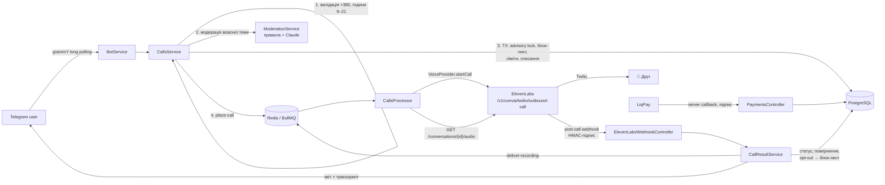

# Ringo — AI-розіграші телефоном (MVP)

Telegram-бот, через який користувач поповнює баланс, вводить номер друга, обирає сценарій
(або пише свою тему) — і AI-агент ElevenLabs дзвонить другові через Twilio та веде живу
розмову українською. Після дзвінка замовник отримує статус, транскрипт і запис.

**Стек:** TypeScript · NestJS 11 · Prisma 6 + PostgreSQL · Redis + BullMQ · grammY ·
ElevenLabs ElevenAgents (Twilio) · LiqPay · Claude (модерація тем) · Docker Compose.

---

## Архітектура



### Модулі (`src/`)

| Модуль | Відповідальність |
|---|---|
| `bot/` | grammY-бот: онбординг 18+, меню, майстер замовлення дзвінка (стан у Redis), адмін-команди |
| `calls/` | `CallsService` (створення дзвінка), `CallsProcessor` (BullMQ: набір, доставка запису, reconcile), `CallResultService` (фінальний статус, повернення, opt-out, сповіщення) |
| `voice/` | **Порт `VoiceProvider`** + адаптер ElevenLabs: HTTP-клієнт, парсер вебхуків, перевірка підпису, контролер |
| `moderation/` | Детерміновані правила (швидкий фільтр) → LLM-класифікатор Claude зі structured output. Fail-closed |
| `limits/` | 1 дзвінок/добу і 3/тиждень на номер (ковзні вікна) під `pg_advisory_xact_lock` |
| `billing/` | Леджер транзакцій; атомарне списання (`balance >= price`), ідемпотентне повернення |
| `payments/` | LiqPay checkout + callback (перевірка підпису, суми, ідемпотентність) |
| `blocklist/` | Блок-лист номерів: `OPT_OUT` (назавжди) і `ADMIN` |
| `admin/` | Статистика, блокування користувачів і номерів, ручне коригування балансу |

### Життєвий цикл дзвінка

```
QUEUED ──(воркер атомарно «захоплює»)──► DIALING ──webhook──► COMPLETED
   │                                       │                   NO_ANSWER  ─┐
   └──(помилка до набору)──► FAILED ◄──────┘                   VOICEMAIL  ─┼─► повернення коштів
                                                               FAILED     ─┘
```

* **Повернення коштів** — якщо зайнято / не відповіли / ніхто не заговорив / автовідповідач / помилка
  провайдера. Повернення ідемпотентне (прапорець `refunded` + унікальний `(callId, REFUND)` у леджері).
* **Автовідповідач** визначається трьома незалежними сигналами: Twilio AMD
  (`telephony_call_config.twilio_machine_detection` → вебхук `answering_machine_detection`),
  системний інструмент агента `voicemail_detection` і поле `voicemail` в data collection.
  Пізній вердикт AMD для вже «успішного» дзвінка теж виправляє статус і повертає гроші.
* **Без подвійних дзвінків:** воркер переводить дзвінок `QUEUED → DIALING` умовним апдейтом
  *до* звернення до провайдера; ретрай job'а бачить `DIALING` і нічого не робить.
* **Reconcile:** якщо вебхук не прийшов за 15 хв, воркер сам забирає результат через
  `GET /v1/convai/conversations/{id}`.
* Вебхуки ідемпотентні: фінальний статус ставиться лише з `QUEUED/DIALING`.

### Заміна голосового провайдера

Уся бізнес-логіка працює з інтерфейсом `VoiceProvider` (`src/voice/voice-provider.interface.ts`):
`startCall`, `fetchResult`, `fetchRecording` + нормалізовані події `VoiceEvent`. Щоб перейти,
наприклад, на SIP-транк: реалізуйте інтерфейс, напишіть контролер, що перетворює вебхуки
провайдера на `VoiceEvent` і викликає `CallResultService.handleEvent`, та змініть одне
підключення в `src/calls/calls.module.ts` (`{ provide: VOICE_PROVIDER, useClass: ... }`).

---

## Безпека та обмеження

| Вимога | Реалізація |
|---|---|
| Модерація власної теми | `ModerationService`: довжина 10–500 → регулярні правила (uk/ru/en стеми) → Claude (`claude-opus-5-5`, structured output, effort `low`). Будь-яка помилка/відмова LLM = **відхилено**. Усі рішення пишуться в `ModerationLog` |
| Заборонені теми | держоргани, ТЦК, поліція, банки, лікарні/медпрацівники, «родич у біді», погрози, вимагання грошей/даних/документів, сексуальний контент, цькування, скам |
| Ім'я замовника | лише літери, 2–40 символів, проганяється через ті самі правила (не можна «Поліція», «ПриватБанк») |
| Ті самі заборони в агента | `agent/system-prompt.uk.md`, розділ «Абсолютні заборони» з пріоритетом над темою |
| Ліміти на номер | 1/добу, 3/тиждень (налаштовується), рахуються всі дзвінки, що могли продзвонити; конкурентні замовлення серіалізуються advisory lock'ом |
| Opt-out | агент виходить з ролі, ввічливо прощається, кладе слухавку; номер іде в `BlockedNumber(OPT_OUT)` **назавжди** (адмін не може розблокувати). Детекція: поле `opt_out` у data collection агента + фразовий fallback по транскрипту |
| Тривалість ≤ 3 хв | `conversation.max_duration_seconds = 180` в конфігурації агента (env `MAX_CALL_DURATION_SEC`, максимум 180) |
| Додатково | лише українські **мобільні** номери; дзвінки тільки 9:00–21:00 за Києвом; агент наприкінці розкриває розіграш і не заперечує, що він AI, якщо щиро спитати; 18+ підтвердження; баланс не може стати від'ємним (CHECK у БД) |

---

## Запуск

### 1. Ключі та акаунти

| Змінна | Звідки взяти |
|---|---|
| `TELEGRAM_BOT_TOKEN` | [@BotFather](https://t.me/BotFather) → `/newbot` |
| `ADMIN_TELEGRAM_IDS` | ваш Telegram ID (наприклад, через @userinfobot), через кому |
| `ELEVENLABS_API_KEY` | ElevenLabs → Developers → API Keys (потрібні права ElevenAgents / Conversational AI) |
| `ELEVENLABS_AGENT_ID` | створюється скриптом `npm run agent:sync` |
| `ELEVENLABS_PHONE_NUMBER_ID` | ElevenLabs → Agents → Phone Numbers (після імпорту Twilio-номера, див. нижче) |
| `ELEVENLABS_WEBHOOK_SECRET` | показується при створенні post-call webhook в ElevenLabs |
| `ANTHROPIC_API_KEY` | [console.anthropic.com](https://console.anthropic.com) → API Keys |
| `LIQPAY_PUBLIC_KEY`, `LIQPAY_PRIVATE_KEY` | кабінет LiqPay → Налаштування → API. Для тестів `LIQPAY_SANDBOX=true` |
| `PUBLIC_BASE_URL` | публічний HTTPS-адрес сервісу (локально — `ngrok http 3000` або `cloudflared`) |

### 2. Локальний запуск через Docker Compose

```bash
cp .env.example .env            # заповніть ключі
docker compose up -d --build    # postgres + redis + app (міграції застосовуються автоматично)
docker compose logs -f app
```

Без Docker для застосунку:

```bash
docker compose up -d postgres redis
npm ci
npx prisma migrate deploy
npm run start:dev
```

Перевірка: `curl localhost:3000/health` → `{"status":"ok"}`.

### 3. Агент ElevenLabs

Системний промпт — `agent/system-prompt.uk.md`, перша фраза — `agent/first-message.uk.txt`.
Скрипт створює агента (якщо `ELEVENLABS_AGENT_ID` порожній) або оновлює існуючого:

```bash
npm run agent:sync -- --dry-run   # подивитись payload
npm run agent:sync                # створити → скопіюйте agent_id у .env
npm run agent:sync                # після змін промпту — оновити
```

Скрипт налаштовує: мову `uk`, `max_duration_seconds=180`, системні інструменти `end_call` і
`voicemail_detection`, data collection `opt_out` / `voicemail`, плейсхолдери динамічних змінних
(`call_id`, `customer_name`, `scenario_title`, `scenario`). Голос — `ELEVENLABS_VOICE_ID`
(оберіть голос, що добре звучить українською), LLM агента — `ELEVENLABS_LLM`
(за замовчуванням `claude-opus-5-5`; для меншої затримки можна обрати швидшу модель зі списку ElevenLabs).

### 4. Twilio-номер в ElevenLabs

1. Купіть номер у [Twilio Console](https://console.twilio.com) → Phone Numbers → Buy a number
   (з підтримкою Voice). Для дзвінків в Україну увімкніть Ukraine у
   *Voice → Settings → Geo Permissions*.
2. ElevenLabs → **Agents → Phone Numbers → Import number → From Twilio**: вкажіть номер,
   Twilio **Account SID** і **Auth Token**. ElevenLabs сам налаштує вебхуки номера в Twilio.
3. Призначте номер агенту Ringo і скопіюйте **Phone Number ID** у `ELEVENLABS_PHONE_NUMBER_ID`.
4. ElevenLabs → **Agents → Settings → Webhooks / Post-call webhook**: URL
   `${PUBLIC_BASE_URL}/webhooks/elevenlabs`, увімкніть події **transcription**,
   **call initiation failure** і **answering machine detection** (аудіо-вебхук не потрібен — запис
   забирається через API). Збережіть секрет у `ELEVENLABS_WEBHOOK_SECRET`.
5. Переконайтеся, що в налаштуваннях приватності агента увімкнене збереження аудіо — інакше
   запис буде недоступний.

### 5. LiqPay

`server_url` передається в кожному платежі автоматично: `${PUBLIC_BASE_URL}/payments/liqpay/callback`.
У sandbox-режимі приймається статус `sandbox`, у бойовому — лише `success` з перевіркою суми й валюти.

---

## Команди бота

Користувач: `/start`, `/call`, `/balance`, `/topup`, `/history`, `/rules`, `/cancel` (або кнопки меню).

Адмін (`ADMIN_TELEGRAM_IDS`):

| Команда | Дія |
|---|---|
| `/stats` | користувачі, дзвінки за статусами, поповнення, повернення, блок-лист |
| `/block_user <id\|@username>` / `/unblock_user ...` | блокування користувача |
| `/block_phone <+380...> [коментар]` / `/unblock_phone <+380...>` | блок-лист номерів (opt-out розблокувати неможливо) |
| `/add_balance <id\|@username> <грн> [коментар]` | ручне коригування балансу (може бути від'ємним) |

---

## Тести

```bash
npm test          # unit-тести (Jest)
npm run lint      # tsc --noEmit
```

Покрито: модерація (правила, LLM, fail-closed, ім'я замовника), ліміти (добові/тижневі вікна,
advisory lock), білінг (атомарне списання, ідемпотентне повернення, від'ємний баланс), LiqPay
(підпис, ідемпотентність, звірка суми), вебхук (HMAC-підпис і replay, парсинг усіх типів подій,
повернення коштів, opt-out, AMD, дублікати), воркер черги (без подвійного набору, ретраї),
валідація українських номерів.

---

## Обмеження MVP і що далі

* Бот працює через long polling — запускайте лише одну репліку з `BOT_POLLING=true`.
* Записи не зберігаються у нас — лише пересилаються в Telegram з API ElevenLabs.
* Формат тіла вебхука `answering_machine_detection` читається захисно (`answered_by`/`result`);
  перевірте на тестовому дзвінку і за потреби уточніть у `elevenlabs.parser.ts`.
* **Юридичне:** перед запуском перевірте вимоги щодо запису розмов, обробки персональних даних
  і телемаркетингу у вашій юрисдикції та умови використання ElevenLabs/Twilio щодо пранк-дзвінків.
